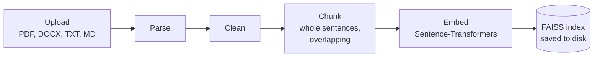
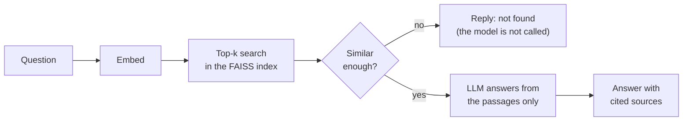

# DocQA - Document Q&A with RAG, FastAPI and FAISS

Upload PDF, DOCX, TXT or Markdown files, then ask questions about them. Answers are written
**only from the retrieved passages** and come with the sources (file, page, similarity score) they
were taken from. When nothing relevant is found, the service says so instead of guessing.

## Highlights

- **Answers only from your documents.** If no retrieved passage is similar enough to the question, the reply is
  "I couldn't find that in the uploaded documents." and the language model is not called at all.
- **Cited answers.** Each answer comes with the passages it was built from; `[1]` in the text refers to the first source.
- **Works with or without an API key.** Claude (Anthropic), any OpenAI-compatible server (OpenAI, Groq, Ollama,
  OpenRouter, ...), or an offline *extractive* mode that quotes the best-matching sentences.
- **Careful ingestion.** PDFs are read page by page. The text is cleaned (hyphenation, wrapped lines, page numbers,
  repeated headers and footers) and cut into sentence-aware chunks with whole-sentence overlap. Uploading the same
  file twice does nothing the second time.
- **Exact cosine search** with FAISS, saved to disk with atomic writes. Falls back to numpy if FAISS is not installed.
- **Service basics.** Optional `X-API-Key` authentication, an upload size limit, clear HTTP status codes, a
  request-time header, a health endpoint, a Dockerfile (unprivileged user, model baked in) and CI.
- **Tested offline.** 200+ tests need no network and no API key. They use real PDF and DOCX files, and the real
  Anthropic and OpenAI SDK clients talking to a local fake server.
- **Measured.** A retrieval evaluation (hit@k and MRR over 34 questions) compares chunk sizes and embedders.

## How it works

**Ingest** - when a file is uploaded:



**Ask** - when a question arrives:



| Module | Responsibility |
|---|---|
| `app/main.py` | FastAPI routes, API-key check, upload size limit, error-to-status mapping |
| `app/schemas.py` | Request and response models (what `/docs` displays) |
| `app/rag.py` | The pipeline that ties everything together: ingest, search, ask |
| `app/parsing.py` | PDF (page by page), DOCX, TXT and MD to text |
| `app/cleaning.py` | Unicode and whitespace clean-up, hyphenation and line-wrap repair, page numbers, repeated headers/footers |
| `app/chunking.py` | Sentence-aware chunks with whole-sentence overlap |
| `app/embeddings.py` | Sentence-Transformers embedder, plus an offline hashing embedder for tests and demos |
| `app/vector_store.py` | Cosine search (FAISS, or numpy), saved to disk atomically |
| `app/llm.py` | The prompt, plus the Anthropic, OpenAI-compatible and extractive answerers |
| `app/config.py` | Settings from `DOCQA_*` environment variables, validated at startup |
| `app/ingest.py` | Command-line bulk loader (no server needed) |
| `app/textutil.py`, `app/errors.py` | Small tokenizer for the offline modes; domain errors |

The reasoning behind these choices, and their trade-offs, is in [docs/DESIGN.md](docs/DESIGN.md).

## Quick start

Needs Python 3.11, 3.12 or 3.13.

```bash
python -m venv .venv
source .venv/bin/activate            # Windows (PowerShell): .venv\Scripts\Activate.ps1
pip install -r requirements-dev.txt  # the app + everything the tests need
pip install -r requirements-ml.txt   # optional: real semantic embeddings (downloads PyTorch)

python -m pytest                     # the test suite - needs no network and no API key
uvicorn app.main:app --reload        # then open http://127.0.0.1:8000/docs
```

- If PowerShell refuses to run the activation script, run `Set-ExecutionPolicy -Scope Process RemoteSigned` first,
  or activate from `cmd` with `.venv\Scripts\activate.bat`.
- If `pip` cannot install `faiss-cpu` on your platform, delete that line from `requirements.txt`. The app notices
  that FAISS is missing and searches with numpy instead (same ranking; the tests cover both).
- The index is saved in `./data` (see `DOCQA_DATA_DIR`). Delete that folder to start from scratch.

Try it from the interactive docs (click **Try it out** on `POST /documents`, upload a file from `sample_docs/`,
then use `POST /ask`), or from a terminal:

```bash
curl -F "file=@sample_docs/pump_station_alarm_codes.txt" http://127.0.0.1:8000/documents
curl -X POST http://127.0.0.1:8000/ask -H "Content-Type: application/json" \
     -d '{"question": "What does alarm code P-101 mean?"}'
```

In Windows PowerShell `curl` is usually an alias for `Invoke-WebRequest`, which takes different arguments.
Use this Python version there (`httpx` is installed with `requirements-dev.txt`):

```python
import httpx

with httpx.Client(base_url="http://127.0.0.1:8000", timeout=60) as client:
    with open("sample_docs/pump_station_alarm_codes.txt", "rb") as f:
        print(client.post("/documents", files={"file": f}).json())
    print(client.post("/ask", json={"question": "What does alarm code P-101 mean?"}).json()["answer"])
```

**No API key? It still works.** Without a key the service runs in *extractive* mode and quotes the best-matching
sentences. That is good enough to demo the pipeline, but it matches words rather than meaning (see
[Limitations](#limitations)). For generated answers set `ANTHROPIC_API_KEY` (Claude), or `OPENAI_API_KEY` plus
`DOCQA_LLM_MODEL` (OpenAI, Groq, Ollama, ...), in your environment or in a `.env` file (copy `.env.example`).
`GET /health` always tells you which embedder and model are active.

Without `sentence-transformers` installed, the app falls back to a lightweight word-matching embedder and logs a
warning. That is fine for tests and demos; install `requirements-ml.txt` for real semantic retrieval.

## Configuration

Everything is configured with environment variables (or a `.env` file in the folder you start the app from;
variables already set in the environment win). Settings are validated at startup, and a bad value stops the app
with a message naming the variable.

| Variable | Default | What it does |
|---|---|---|
| `ANTHROPIC_API_KEY` | - | Claude writes the answers (read by the Anthropic SDK) |
| `OPENAI_API_KEY` | - | An OpenAI-compatible model writes the answers; also set `DOCQA_LLM_MODEL`. Ollama accepts any value |
| `OPENAI_BASE_URL` | OpenAI | URL of an OpenAI-compatible server, for example `http://localhost:11434/v1` for Ollama |
| `DOCQA_LLM_PROVIDER` | `auto` | `auto`, `anthropic`, `openai` or `extractive`. `auto` picks Anthropic if its key is set, else an OpenAI-compatible model if its key and `DOCQA_LLM_MODEL` are set, else extractive |
| `DOCQA_LLM_MODEL` | `claude-haiku-5-5` (Anthropic) | Model name. Required for `openai` |
| `DOCQA_LLM_TIMEOUT` | `60` | Seconds to wait for the model |
| `DOCQA_EMBEDDING_BACKEND` | `auto` | `auto`, `sentence-transformers` or `hashing`. `auto` uses Sentence-Transformers when it loads, otherwise the offline hashing embedder (with a warning). Set it explicitly in production |
| `DOCQA_EMBEDDING_MODEL` | `sentence-transformers/all-MiniLM-L6-v2` | Any Sentence-Transformers model |
| `DOCQA_CHUNK_SIZE` | `180` | Maximum words per chunk (at least 20) |
| `DOCQA_CHUNK_OVERLAP` | `30` | Words repeated between neighbouring chunks (whole sentences, so often fewer) |
| `DOCQA_TOP_K` | `4` | Chunks retrieved per question (1 to 20) |
| `DOCQA_MIN_SCORE` | the embedder's own | Chunks less similar than this count as "not relevant". The defaults are `0.2` for MiniLM and `0.05` for the hashing embedder |
| `DOCQA_DATA_DIR` | `data` | Where the index is saved |
| `DOCQA_MAX_UPLOAD_MB` | `10` | Largest accepted upload |
| `DOCQA_API_KEY` | - | When set, clients must send it in an `X-API-Key` header (see [Authentication](#authentication)) |

Chunk settings only affect documents uploaded afterwards. If the embedding model changes between runs, the saved
chunks are re-embedded at startup, so old and new vectors are never mixed.

## API

Interactive documentation, with a **Try it out** button for every endpoint, is served at `/docs`.

| Method | Path | What it does |
|---|---|---|
| `POST` | `/documents` | Upload a file (multipart field `file`; `.pdf`, `.docx`, `.txt`, `.md`). `201` when new, `200` when identical bytes are already indexed |
| `GET` | `/documents` | List indexed documents |
| `DELETE` | `/documents/{doc_id}` | Remove a document and its chunks (`204`) |
| `POST` | `/ask` | Answer a question with cited sources |
| `POST` | `/search` | Show the raw top-k chunks and scores, without calling a model and without the relevance cut-off. Useful for tuning |
| `GET` | `/health` | Liveness, plus the embedder, model and index size in use |

`/ask` takes `{"question": "...", "top_k": 4, "doc_id": "..."}`. Only `question` (3 to 2000 characters) is required;
`top_k` (1 to 20) and `doc_id` (search one document only) are optional. `/search` takes the same, with `query`
instead of `question`. Responses carry an `X-Process-Time-ms` header with the time the server took.

The examples below are real responses, captured with no API key and without `sentence-transformers`, so the answer
comes from the extractive mode and the scores from the offline embedder. With the real embedding model the scores
differ (its default cut-off is 0.2).

**Upload** (`201`; sending the same bytes again returns the same body with `200`):

```json
{"doc_id": "576cba036fb7", "filename": "pump_station_alarm_codes.txt", "num_chunks": 2}
```

**Ask** (`text` is shortened here):

```json
{
  "answer": "Code P-101 means low suction pressure. [1]",
  "grounded": true,
  "answered_by": "extractive",
  "sources": [
    {
      "doc_id": "576cba036fb7",
      "filename": "pump_station_alarm_codes.txt",
      "chunk_id": 0,
      "page": null,
      "score": 0.3231,
      "text": "Pump Station Alarm Code Reference (SAMPLE DOCUMENT - ...)\nOverview\n...\nCode P-101 means low suction pressure. It appears when the suction pressure stays below 0.5 bar for more than 30 seconds. ..."
    },
    {
      "doc_id": "576cba036fb7",
      "filename": "pump_station_alarm_codes.txt",
      "chunk_id": 1,
      "page": null,
      "score": 0.1083,
      "text": "Do not attempt more than two restarts. ..."
    }
  ]
}
```

`sources` lists every retrieved passage that passed the relevance cut-off, best first. A marker such as `[2]` in
the answer means `sources[1]`. `page` is the 1-based PDF page (`null` for other formats). `answered_by` names the
model that wrote the answer.

**Ask something the documents do not cover** - the model is not called, and `grounded` is `false`:

```json
{"answer": "I couldn't find that in the uploaded documents.", "grounded": false, "answered_by": null, "sources": []}
```

With nothing uploaded yet, `/ask` answers "No documents have been uploaded yet." the same way.

**Errors** always have a JSON body with a `detail` field:

| Status | When | Example `detail` |
|---|---|---|
| `401` | `DOCQA_API_KEY` is set and the header is missing or wrong | `Missing or invalid API key.` |
| `404` | Unknown `doc_id` (delete, or `doc_id` in `/ask` and `/search`) | `No document with id '000000000000'.` |
| `413` | Upload larger than `DOCQA_MAX_UPLOAD_MB` | `File is larger than the 1 MB limit.` |
| `415` | Unsupported file type | `Unsupported file type '.exe'. Use one of: .pdf, .docx, .txt, .md` |
| `422` | Empty or unreadable file, or an invalid request body | `The uploaded file is empty.` or `No readable text found (a scanned PDF? OCR is not supported).` Invalid JSON bodies get FastAPI's standard list of field errors |
| `502` | The language-model call failed (bad key, rate limit, timeout, ...) | `The language model request failed; see the server logs.` |

### Authentication

Set `DOCQA_API_KEY` and every endpoint except `/health` (and the documentation pages `/`, `/docs`, `/redoc`,
`/openapi.json`) needs the header `X-API-Key: <your key>`. In `/docs`, click **Authorize** and paste it. The key is
checked with a constant-time comparison. It is one shared secret: enough to stop strangers spending your LLM
credits, not a user system. The service speaks plain HTTP, so put HTTPS in front of it before real use (the
[AWS guide](docs/DEPLOY_AWS.md) shows one way).

## Docker

```bash
cp .env.example .env        # Windows: copy .env.example .env  (every value in it is optional)
docker compose up --build   # then open http://localhost:8000/docs
```

The first build downloads PyTorch (CPU build) and the embedding model and bakes both into the image, so later
starts are quick and need no internet.

- The saved index lives in a named Docker volume mounted at `/data`. It survives restarts and rebuilds
  (`docker compose down` keeps it, `docker compose down -v` deletes it). Compose prefixes the volume name with the
  project (folder) name; `docker volume ls` shows it.
- API keys are read from `.env` when the container starts. They are never copied into the image.
- Leave `DOCQA_DATA_DIR` out of `.env` when using Docker: the image already sets it to `/data`.
- The container runs **one** worker on purpose. The index lives in the process's memory and is saved to disk, so
  several workers would each keep their own copy and overwrite each other's saves.
- The image runs as an unprivileged user and has a health check on `/health`.

## Deploying to AWS

[docs/DEPLOY_AWS.md](docs/DEPLOY_AWS.md) is a step-by-step guide for running the Docker setup on one EC2 instance:
security group, Docker install, secrets, health checks, updates, backups, optional HTTPS, cost control and
troubleshooting. It also points to container services (ECS, App Runner, Azure Container Apps).

## Tests

```bash
python -m pytest                  # 200+ tests: no network, no API key
python -m pytest --cov=app        # with a coverage report
python -m pytest -m integration   # also loads the real embedding model (downloaded on first use)
python tools/mutation_check.py    # breaks the code on purpose, in a copy, to check that the tests notice
python -m ruff check .            # lint
```

What they cover:

- parsing of real PDF (generated with fpdf2) and DOCX (python-docx) files, cleaning and chunking edge cases;
- the vector store on both the FAISS and the numpy back end, which must rank identically, plus persistence
  (save and reload, inconsistent files, a changed embedding model);
- the pipeline's refusal behaviour: nothing relevant means no model call, and a model that says "not found" is
  reported as not grounded;
- the Anthropic and OpenAI wrappers, using the real SDK clients against a small local fake server, so request
  building and response parsing are exercised rather than mocked away;
- the HTTP API: uploads and duplicates, size limits, authentication, every error status, and the bulk-ingest tool.

## Evaluation

```bash
python -m evaluation.run_eval --embedder hashing                          # offline baseline, no downloads
python -m evaluation.run_eval --embedder sentence-transformers            # the real model
python -m evaluation.run_eval --embedder hashing --show-misses            # list the questions it got wrong
```

The script measures retrieval on its own (no language model): for each of 34 questions, is the chunk containing the
answer among the top k? It reports hit@1, hit@3, hit@5 and MRR for several chunk sizes. With the offline baseline
embedder and 180-word chunks, hit@3 is 0.97 and MRR is 0.94. The questions were written against the sample
documents and share their vocabulary, so this shows that the pipeline works, not that it will score the same on
other documents. Full results and how to read them: [docs/eval_results.md](docs/eval_results.md). With the real embedding model (all-MiniLM-L6-v2) and 180-word chunks, the right chunk is first for 85% of the 34 questions (hit@1 0.85), in the top 3 for 97% (hit@3 0.97) and always in the top 5 (hit@5 1.00); MRR is 0.92.

## Continuous integration

`.github/workflows/ci.yml` runs on every push. It lints and tests on Python 3.11, 3.12 and 3.13, then builds the
Docker image, starts it, uploads a sample document and asks a question using the real embedding model.

## Design notes

[docs/DESIGN.md](docs/DESIGN.md) explains the main decisions and their trade-offs: refusing by default, cleaning and
chunking, the embedder interface and its offline fallback, why exact FAISS search, atomic persistence, prompt
hygiene, error handling, and how the tests are built. It ends with a table of limitations and what to do about each.

## Limitations

- **Text only.** Scanned PDFs (no OCR), tables and images are not understood. A scanned PDF is rejected with a `422`.
- **Tables and page breaks are flattened.** A PDF table is read one row per line and a DOCX table one cell per line
  (empty cells vanish). PDF pages are chunked separately, so a fact that runs across a page break is split.
- **Text encodings.** Text files are read as UTF-8, UTF-16 (with a byte order mark) or Windows-1252. Other encodings
  such as Shift-JIS come out garbled.
- **One shared index and one API key.** There are no per-user collections.
- **One process.** The index is held in memory and saved to disk, so run a single worker or replica.
- **Dense retrieval only.** Embedding search can be weak on exact identifiers such as part numbers or error codes.
  Adding keyword (BM25) search and a reranker is the usual fix.
- **Extractive mode is a fallback.** It matches words rather than meaning (it only strips plurals), so a question
  phrased differently from the document can quote the wrong sentences. For example, "How often is the transformer
  oil sampled?" does not find "Dissolved gas analysis of the insulating oil is performed every 12 months." Use an
  LLM provider for real answers.
- **The relevance cut-off is a starting point.** `0.2` for MiniLM has not been tuned on your documents. Use `/search`
  to look at scores and `DOCQA_MIN_SCORE` to change it.
- **Upload size limit.** It relies on the `Content-Length` header and a bounded read. Behind a proxy, also set a
  request-size limit there.

## Project layout

```
app/                 the service (see "How it works")
tests/               pytest suite
tools/               mutation_check.py: deliberate bugs, one at a time, to see whether the tests catch them
evaluation/          retrieval evaluation script and its 34-question set
sample_docs/         six fictional plant-maintenance documents for demos and evaluation
docs/                DESIGN.md, DEPLOY_AWS.md, eval_results.md
.github/workflows/   CI: lint, tests on three Python versions, Docker build and smoke test
Dockerfile, docker-compose.yml, .env.example
requirements.txt, requirements-ml.txt, requirements-dev.txt, pyproject.toml
```
